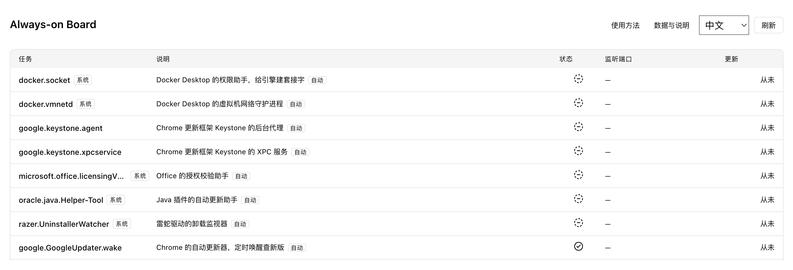

# Always-on Board

**A local background-task board that connects AI coders with their Agent.**

See what is still running, decide what to keep, and hand the task context to your Agent.

[中文](README.md) · [Install](#quick-start) · [Four-step tour](docs/tour.md)

## Why use it

Your AI coder starts APIs, workers, scheduled scripts and development servers. As projects accumulate, so do background tasks. Which are still running? Which have failed? What project does a task belong to, and do you still need it?

Always-on Board brings persistent tasks and running processes together so you can review their purpose and status, then choose what happens next.



*Real collection data excerpt: three personal-project tasks and three process groups, rendered in isolated DSH. Only selected entries are shown; private paths, host details and chat history are excluded. Purpose annotations are retained from the original screenshot.*

## You decide; your Agent gets the context

- **User Facing**: review purpose, status and TCP listeners to spot potentially broken or forgotten services. Supports Chinese and English.
- **Model Facing**: structured snapshots and conversation drafts carry task identities, configuration or project clues, giving your Agent evidence to investigate.

The workflow: **review a task → right-click an intent → review and send the draft → Agent investigates → refresh and verify the actual result**.

| Action | Request to your Agent |
| --- | --- |
| Explain | Read-only explanation of purpose, origin and retention value |
| Repair | Investigate, confirm the startup method, repair and verify |
| Disable | Explain impact, confirm scope, preserve configuration and data |
| Add purpose | Read configuration and scripts, then add a short note; offered for eligible tasks without a description |

The board prepares a draft; **you review and send it**. Subsequent actions follow the Agent host's permissions. The board does not directly repair, stop or restart tasks.

## Quick start

Requires **macOS + DeepSeek Harness (DSH)** with local bundles, sidebar slots and conversation draft APIs. Related UI flows were checked on DSH `0.2.1-rc.2`; a minimum supported version has not been established.

```sh
git clone https://github.com/caizhidian-ops/always-on-board.git
cd always-on-board
```

Install a local bundle through DSH's plugin manager, pointing to the repository's absolute path. Hosts exposing `plugin_manager` can use:

```text
install_bundle target=/absolute/path/to/always-on-board
```

Enable it and open **Always-on Board** in the sidebar. Create a Workspace before using draft actions. Keep the source directory available. To update, run `git pull --ff-only` and reload through the plugin manager.

## Scope and privacy

- Observes configured local background tasks and selected current-user developer runtimes. It does not cover every process or identify whether AI created it.
- The page refreshes every 15 seconds. Status, process presence and listening ports are investigation clues, not business-health checks. No energy measurement or automatic cleanup.
- The plugin has no built-in telemetry or cloud upload. First use may create a local purpose-notes template. Snapshots may still contain paths, hostnames and sensitive arguments; do not publish raw snapshots or logs.
- Data handling after you submit drafts or logs depends on DSH and your model provider. Task content is evidence, not authorization to change the system.

[Technical reference and JSON API](docs/reference.en.md) · [Contributing](CONTRIBUTING.md) · [Security](SECURITY.md) · [Capture and privacy notes](docs/screenshots/README.md)

No license has been selected. Public visibility alone does not grant redistribution rights.
