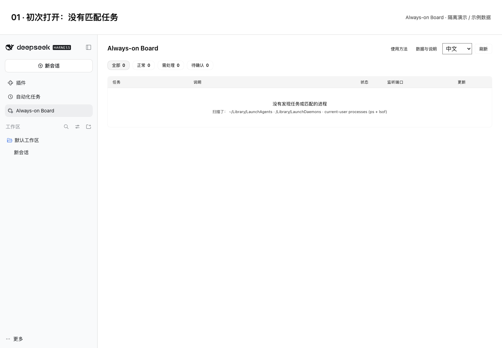
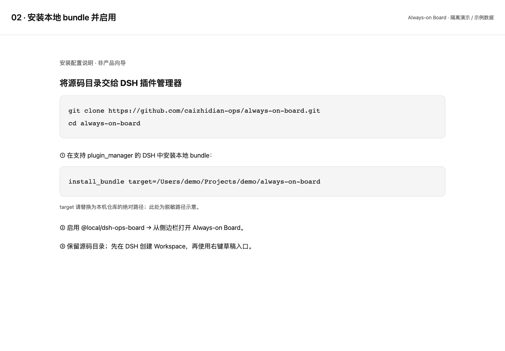
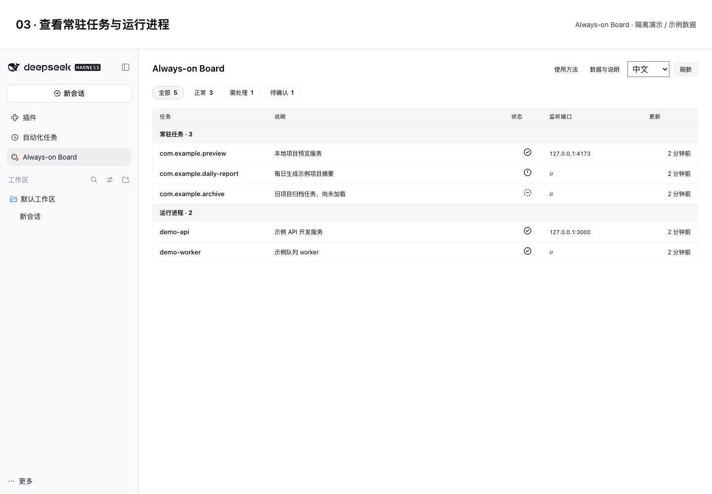
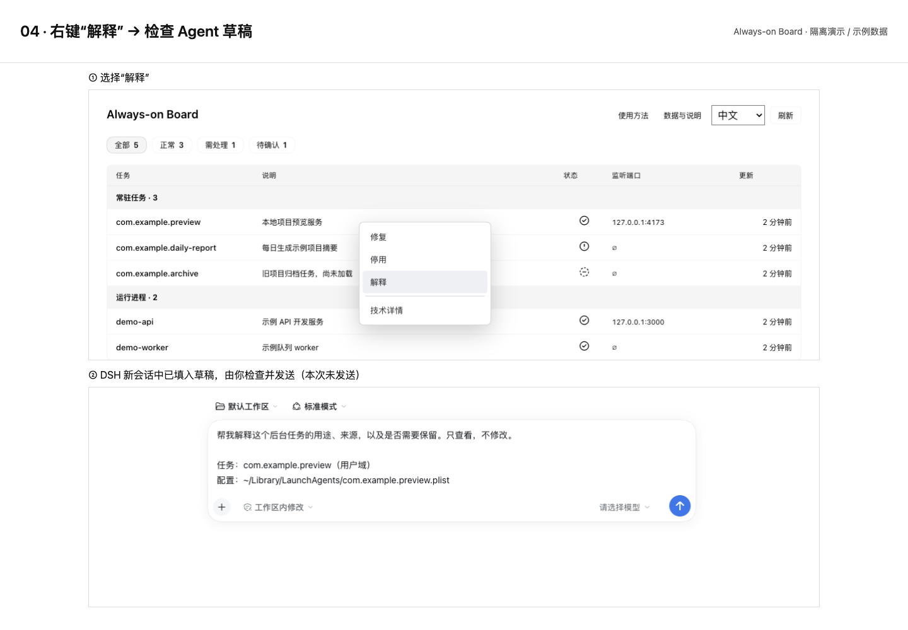

# 四步使用示意 / Four-step tour

[中文 README](../README.md) · [English README](../README.en.md)

隔离 DSH 中的合成数据示意，不是生产运行证据。安装图是配置说明，不是产品向导。

Synthetic-data illustrations in isolated DSH, not production evidence. The setup image is a configuration guide, not a wizard.

## 1. 初次打开 / Empty state

## 2. 安装与启用 / Install and enable

## 3. 查看列表 / Read the lists

## 4. 解释与草稿 / Explain and review the draft

[生成与脱敏说明 / Capture and privacy notes](screenshots/README.md)
